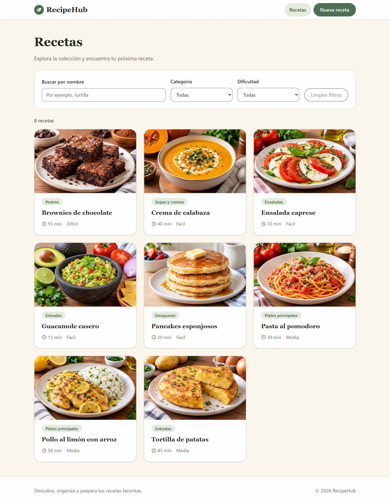
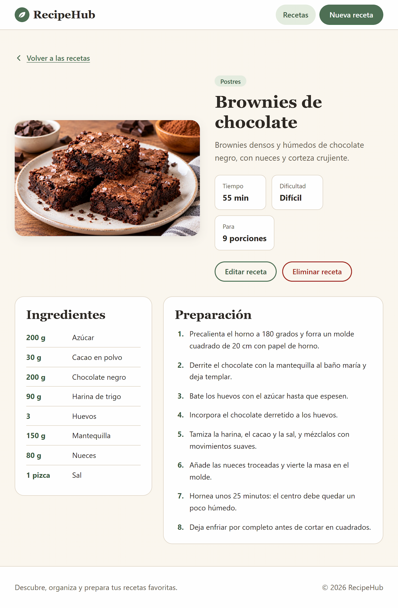
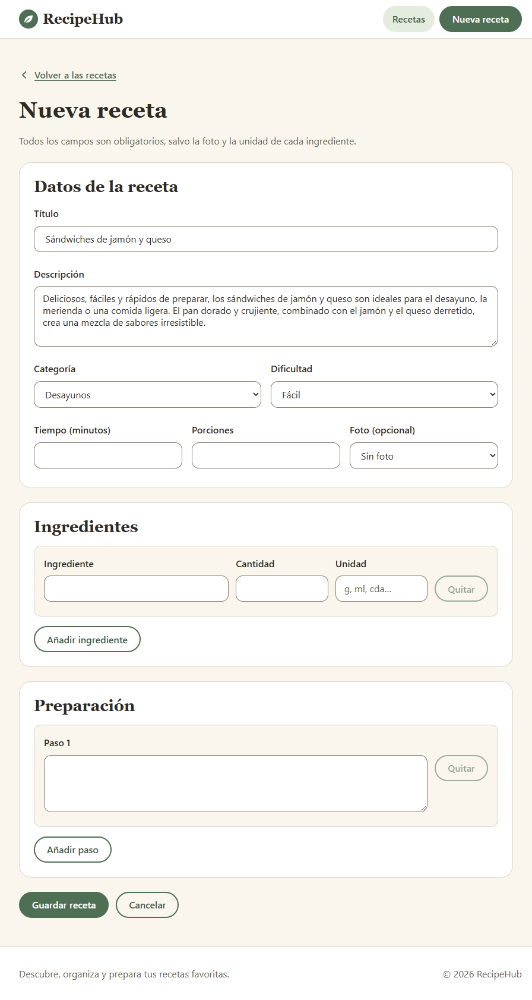
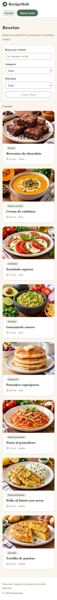
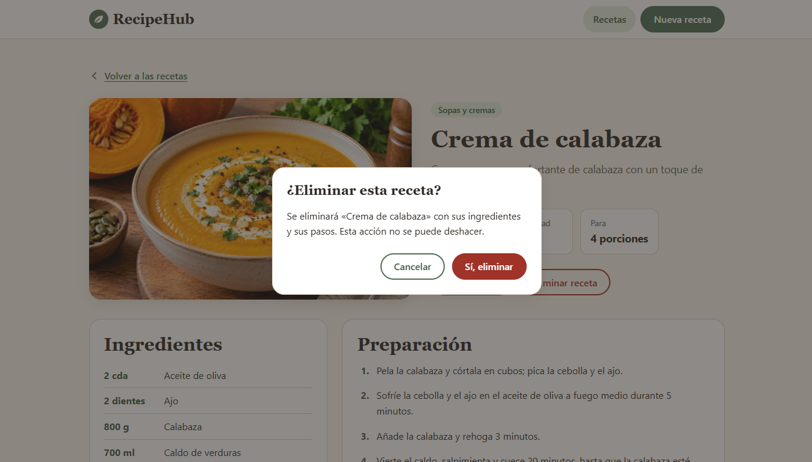
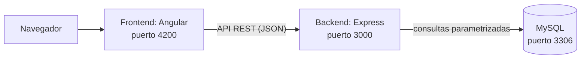
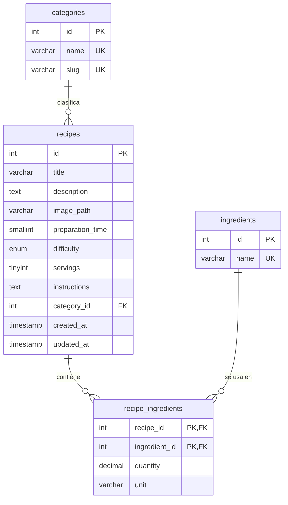

# RecipeHub

> Descubre, organiza y prepara tus recetas favoritas.

RecipeHub es una aplicación web para explorar y gestionar recetas de cocina. Permite consultar un catálogo de recetas, buscar y filtrar, ver los ingredientes y los pasos de preparación, y crear, editar y eliminar recetas. Es el quinto y último proyecto de mi portafolio como desarrollador web, y lo he usado para practicar un stack distinto del de los anteriores: **Angular, Node.js, Express y MySQL**.

> Por ahora no hay una demostración publicada en línea. El proyecto se ejecuta en local siguiendo las instrucciones de [Instalación](#instalación-y-puesta-en-marcha-en-windows).

## Capturas











## Funcionalidades

- **Catálogo** de recetas en tarjetas, con foto, categoría, tiempo y dificultad.
- **Búsqueda por nombre** (sin distinguir mayúsculas ni tildes) y **filtros** por categoría y dificultad, combinables y con botón para limpiarlos.
- **Detalle** de cada receta: foto, descripción, tiempo, dificultad, porciones, ingredientes con cantidades y pasos numerados.
- **Crear, editar y eliminar** recetas. Los formularios validan los datos en el navegador y en el servidor, y los errores del servidor se muestran junto a cada campo. Eliminar pide confirmación.
- **Estados de carga, error y catálogo vacío** en todas las pantallas.
- **Modo de solo lectura** para una demostración pública: la API rechaza las escrituras y la interfaz oculta los botones correspondientes.
- Diseño **responsive** (móvil, tableta y escritorio) y atención a la **accesibilidad**.

## Tecnologías

| Capa | Tecnología | Versión de desarrollo |
|---|---|---|
| Frontend | Angular (componentes independientes, formularios reactivos, enrutador, `HttpClient`) | 22.2.1 |
| Lenguaje del frontend | TypeScript | 6.0.3 |
| Estilos | CSS propio con variables, sin librerías de componentes | |
| Backend | Node.js con Express (JavaScript con módulos ES) | Node 24.21 · Express 5.2.1 |
| Base de datos | MySQL, con el driver `mysql2` | MySQL 8.4.11 LTS · mysql2 3.24.5 |
| Seguridad del servidor | `helmet`, `cors`, `express-rate-limit` | |
| Pruebas | Vitest (en Angular) y el ejecutor de pruebas incluido en Node | |
| Herramientas | Git, GitHub, Visual Studio Code, npm 11 | |

## Arquitectura



- El **frontend** es una aplicación de una sola página que consume la API con `HttpClient`.
- El **backend** valida los datos, aplica los límites de peticiones y ejecuta consultas SQL parametrizadas con un usuario de base de datos de privilegios mínimos.
- La **base de datos** guarda recetas, categorías e ingredientes en tablas relacionadas.

### Estructura de carpetas

```
RecipeHub/
├── backend/
│   ├── requests/          Ejemplos de peticiones en JSON
│   ├── src/
│   │   ├── middleware/    Errores centralizados y modo de solo lectura
│   │   ├── routes/        Rutas de categorías y recetas
│   │   ├── app.js         Aplicación Express (seguridad, CORS, límites, rutas)
│   │   ├── config.js      Lectura y validación de las variables de entorno
│   │   ├── db.js          Conexión a MySQL
│   │   └── ...            Validadores y arranque del servidor
│   ├── test/              Pruebas del validador de recetas
│   └── .env.example       Plantilla de configuración (sin secretos)
├── database/
│   ├── schema.sql         Creación de las tablas
│   └── seed.sql           Categorías y 8 recetas de ejemplo
├── docs/capturas/         Capturas de pantalla de este documento
├── frontend/
│   ├── public/images/     Fotos de las recetas
│   └── src/app/
│       ├── core/          Modelos, servicio de la API y servicios comunes
│       ├── features/      Páginas: catálogo, detalle, formulario y 404
│       ├── layout/        Cabecera, pie y avisos
│       └── shared/        Componentes y utilidades reutilizables
└── README.md
```

## Instalación y puesta en marcha (en Windows)

Los comandos son para el **Símbolo del sistema (CMD)**.

### Requisitos previos

- [Node.js](https://nodejs.org) 24 LTS (24.15 o superior) y npm.
- [MySQL Community Server](https://dev.mysql.com/downloads/mysql/) 8.4 LTS (probado con 8.4.11).
- [Git](https://git-scm.com).

Comprueba las versiones:

```
node -v
npm -v
mysql --version
git --version
```

### 1. Descargar el proyecto

```
git clone <URL-DEL-REPOSITORIO>
cd RecipeHub
```

### 2. Preparar la base de datos

Abre una sesión de MySQL como administrador (`mysql -u root -p`) y crea la base de datos y un usuario propio para la aplicación. Cambia `CAMBIA_ESTA_CLAVE` por una contraseña de tu elección:

```sql
CREATE DATABASE recipehub CHARACTER SET utf8mb4 COLLATE utf8mb4_0900_ai_ci;
CREATE USER 'recipehub_app'@'localhost' IDENTIFIED BY 'CAMBIA_ESTA_CLAVE';
GRANT SELECT, INSERT, UPDATE, DELETE ON recipehub.* TO 'recipehub_app'@'localhost';
EXIT
```

Después, desde la carpeta del proyecto, crea las tablas y carga los datos de ejemplo (te pedirá la contraseña de `root`):

```
mysql -u root -p < database\schema.sql
mysql -u root -p --default-character-set=utf8mb4 < database\seed.sql
```

Para comprobar que las relaciones funcionan:

```
mysql -u root -p recipehub -e "SELECT r.title, c.name AS categoria, COUNT(ri.ingredient_id) AS ingredientes FROM recipes r JOIN categories c ON c.id = r.category_id LEFT JOIN recipe_ingredients ri ON ri.recipe_id = r.id GROUP BY r.id, r.title, c.name ORDER BY r.id;"
```

Debe mostrar las 8 recetas con su categoría y el número de ingredientes.

### 3. Arrancar el backend

```
cd backend
copy .env.example .env
notepad .env
npm ci
npm run dev
```

En `.env`, escribe la contraseña de `recipehub_app` en `DB_PASSWORD`. El servidor debe mostrar `API de RecipeHub en http://localhost:3000`. Para comprobarlo, abre <http://localhost:3000/api/health>: debe responder `"status":"ok"` y `"database":"ok"`.

### 4. Arrancar el frontend

En otra ventana de CMD:

```
cd frontend
npm ci
npm start
```

Abre <http://localhost:4200>.

## Variables de entorno

Se definen en `backend/.env` (hay una plantilla en `backend/.env.example`). El archivo `.env` **no se sube a Git**.

| Variable | Ejemplo | Descripción |
|---|---|---|
| `NODE_ENV` | `development` | Entorno de ejecución |
| `PORT` | `3000` | Puerto de la API |
| `DB_HOST` | `127.0.0.1` | Servidor MySQL (usar `127.0.0.1` y no `localhost`) |
| `DB_PORT` | `3306` | Puerto de MySQL |
| `DB_USER` | `recipehub_app` | Usuario de la aplicación |
| `DB_PASSWORD` | `cambia_esta_clave` | Contraseña de ese usuario |
| `DB_NAME` | `recipehub` | Nombre de la base de datos |
| `DB_SSL` | `false` | `true` para bases de datos remotas con TLS |
| `DB_CONNECTION_LIMIT` | `10` | Conexiones máximas del pool |
| `CORS_ORIGINS` | `http://localhost:4200` | Orígenes permitidos, separados por comas y sin barra final |
| `READ_ONLY_DEMO` | `false` | Con `true`, la API rechaza crear, editar y eliminar |
| `RATE_LIMIT_WINDOW_MS` | `900000` | Ventana de los límites de peticiones (15 minutos) |
| `RATE_LIMIT_MAX` | `100` | Peticiones por IP en esa ventana |
| `WRITE_RATE_LIMIT_MAX` | `20` | Escrituras por IP en esa ventana |

La dirección de la API del frontend se define en `frontend/src/environments/`.

## Base de datos



- Las recetas pertenecen a una categoría (clave foránea con `ON DELETE RESTRICT`).
- Los ingredientes se relacionan con las recetas en una tabla intermedia que guarda la cantidad y la unidad. Al borrar una receta se borran sus líneas (`ON DELETE CASCADE`).
- Restricciones `CHECK` en tiempo, porciones y cantidades.
- Los pasos de preparación se guardan en un campo de texto, uno por línea.

## API REST

Todas las respuestas son JSON. Las correctas llevan `{ "ok": true, "data": ... }` y las erróneas `{ "ok": false, "error": { "message": "...", "details": [...] } }`. Los datos de ejemplo de cada operación están en `backend/requests/`.

| Método | Ruta | Descripción | Respuestas |
|---|---|---|---|
| GET | `/api/health` | Estado de la API y de la base de datos | 200, 503 |
| GET | `/api/categories` | Lista de categorías | 200 |
| GET | `/api/recipes?search=&category=&difficulty=` | Lista de recetas con filtros opcionales | 200, 400 |
| GET | `/api/recipes/:id` | Receta completa con ingredientes | 200, 400, 404 |
| POST | `/api/recipes` | Crea una receta | 201, 400, 422 |
| PUT | `/api/recipes/:id` | Reemplaza una receta | 200, 400, 404, 422 |
| DELETE | `/api/recipes/:id` | Elimina una receta | 204, 400, 404 |

Otras respuestas posibles: `403` (modo de solo lectura), `413` (cuerpo demasiado grande), `429` (demasiadas peticiones) y `500`. Los errores de validación (`422`) indican el campo afectado, por ejemplo `ingredients[0].quantity`.

Ejemplo de cuerpo para crear una receta:

```json
{
  "title": "Tostadas de aguacate",
  "description": "Desayuno rápido con aguacate machacado sobre pan tostado.",
  "imagePath": "guacamole.jpg",
  "preparationTime": 10,
  "difficulty": "easy",
  "servings": 2,
  "categoryId": 1,
  "instructions": ["Tuesta el pan.", "Aplasta el aguacate con sal.", "Unta y sirve."],
  "ingredients": [
    { "name": "Pan de molde", "quantity": 4, "unit": "rebanadas" },
    { "name": "Aguacates", "quantity": 1, "unit": "" }
  ]
}
```

## Pruebas

```
cd backend
npm test

cd ..\frontend
npm test -- --no-watch
```

Hay 12 pruebas en el backend (validación de recetas) y 108 en el frontend (servicio de la API, validadores, componentes, formularios, rutas, diálogo de confirmación y modo de solo lectura).

## Seguridad

- Consultas SQL **parametrizadas** y validación de todos los datos de entrada en el servidor.
- Usuario de base de datos con **privilegios mínimos** (solo lectura y escritura de datos, sin permisos para modificar tablas), y MySQL limitado a `127.0.0.1`.
- Cabeceras de seguridad con `helmet`, **CORS con lista de orígenes permitidos** y tamaño máximo del cuerpo de las peticiones.
- **Límite de peticiones** por IP, más estricto para las escrituras.
- Manejo de errores centralizado que no revela detalles internos.
- Sin secretos en el repositorio: la configuración va en `.env`, que está ignorado por Git.
- Angular escapa por defecto el texto que se muestra, y el código no usa `innerHTML`.
- Las dependencias se revisaron con `npm audit` (sin vulnerabilidades conocidas al preparar esta versión).

> **Aviso:** esta aplicación **no tiene autenticación**. Si el modo de escritura estuviera expuesto en internet, cualquiera podría crear, modificar o borrar recetas, o llenar la base de datos. Por eso el modo `READ_ONLY_DEMO=true` está pensado para cualquier demostración pública, y el CRUD completo se usa solo en local.

## Accesibilidad

- Estructura semántica, enlace para **saltar al contenido** y títulos jerárquicos.
- Etiquetas visibles en todos los campos, errores enlazados a su campo y foco que se mueve al primer error al enviar.
- Foco visible y navegación completa **con teclado**; diálogo de confirmación nativo (`<dialog>`) que atrapa el foco y se cierra con Escape.
- Colores elegidos con una relación de contraste de al menos 4,5:1 para el texto, calculada durante el diseño.
- Respeta la preferencia de menos movimiento del sistema.
- Revisado manualmente con teclado y en distintos tamaños de pantalla.

## Decisiones de diseño

- **JavaScript con módulos ES en el backend**, para mantener el servidor sencillo; TypeScript se usa en Angular.
- **Ingredientes en tablas relacionales** (no en JSON) para practicar claves foráneas, relaciones muchos a muchos y `JOIN`.
- **Fotos de una lista cerrada**, sin subida de archivos, para no añadir dependencias ni almacenamiento.
- **Modo de solo lectura** en lugar de autenticación, porque el alcance excluye usuarios y roles.
- **Dependencias mínimas** y versiones con una antigüedad mínima de dos semanas al instalarlas.

## Limitaciones conocidas

- Sin autenticación ni cuentas de usuario (ver el aviso de seguridad).
- Sin subida de imágenes: las fotos nuevas se añaden a mano a `frontend/public/images` y a la lista de `frontend/src/app/core/photos.ts`.
- El orden de los ingredientes es alfabético y los pasos no se pueden reordenar en el formulario.
- Sin paginación del catálogo ni filtros en la dirección de la página.
- Los ingredientes que dejan de usarse se quedan en la base de datos.
- El backend solo tiene pruebas automáticas del validador; el resto de la API se comprobó con peticiones manuales.
- La dirección de la API de producción (`frontend/src/environments/environment.ts`) es un valor provisional.

## Mejoras futuras

Autenticación y roles, paginación, filtros en la dirección, reordenar pasos, subida de fotos, pruebas de integración del backend y limpieza de ingredientes sin uso.

## Créditos

- Las **fotografías de las recetas son imágenes generadas con inteligencia artificial** por el autor.
- Iconos y marca dibujados a mano en SVG.

## Autor

Juan Angel